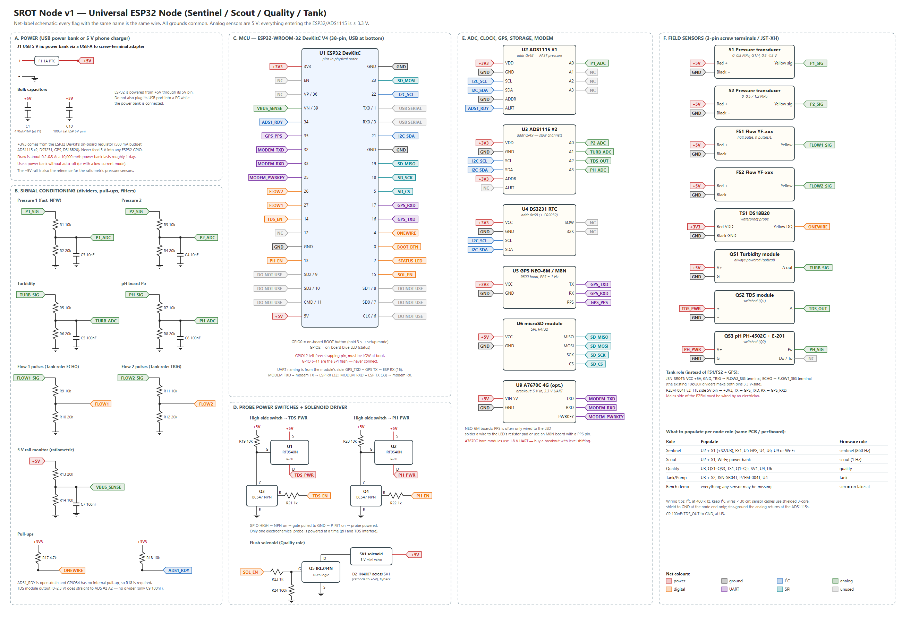

# SROT Node v1: circuit and components

- Vector schematic: [srot-node-v1-schematic.svg](srot-node-v1-schematic.svg). It is generated by [gen_schematic.py](gen_schematic.py); edit that script and re-run it after any pin change.
- This is a net-label schematic: every flag with the same name is the same wire.
- One board serves every role. You populate only the parts a role needs (see the table on the schematic) and choose the role in the app.

## Pin map (must match `firmware/src/pins.h`)

| ESP32 GPIO | Net | Connects to | Notes |
|---|---|---|---|
| 21 / 22 | I2C_SDA / I2C_SCL | ADS1115 ×2, DS3231 | 400 kHz |
| 34 | ADS1_RDY | ADS1115 #1 ALRT | Needs the 10k pull-up (R18): GPIO34 is input-only with no pull-up |
| 35 | GPS_PPS | GPS PPS | 1 pulse/s, gives µs time sync |
| 16 / 17 | GPS_TXD / GPS_RXD | GPS TX → ESP RX16, ESP TX17 → GPS RX | Tank role: PZEM-004T on the same pins |
| 27 | FLOW1 | Flow sensor 1 via 10k/20k divider | Tank role: JSN-SR04T ECHO |
| 26 | FLOW2 | Flow sensor 2 via 10k/20k divider | Tank role: JSN-SR04T TRIG |
| 4 | ONEWIRE | DS18B20 DQ, 4.7k pull-up (R17) | |
| 14 | TDS_EN | Q3 base (1k) → Q1 high-side switch | |
| 13 | PH_EN | Q4 base (1k) → Q2 high-side switch | |
| 15 | SOL_EN | Q5 gate (1k, 100k pull-down) | Flush solenoid |
| 36 (VP) | not used | (12 V battery monitor, not needed with a power bank) | |
| 39 (VN) | VBUS_SENSE | 5 V rail via 20k/10k | Ratiometric correction |
| 18 / 19 / 23 / 5 | SD_SCK / MISO / MOSI / CS | microSD | |
| 32 / 33 / 25 | MODEM RX / TX / PWRKEY | A7670C (optional) | Firmware v1 uses Wi-Fi; pins are reserved |
| 0 | BOOT_BTN | On-board button | Hold 3 s → setup (AP) mode |
| 2 | STATUS_LED | On-board LED | Slow blink = AP mode, solid = online |

ADS1115 channels:

| ADC | Ch | Signal | Front-end |
|---|---|---|---|
| #1 (0x48) | A0 | Pressure 1 (fast, 860 SPS continuous) | 10k/20k divider + 10 nF |
| #2 (0x49) | A0 | Pressure 2 | 10k/20k + 10 nF |
| #2 | A1 | Turbidity | 10k/20k + 100 nF |
| #2 | A2 | TDS | direct + 100 nF |
| #2 | A3 | pH (PH-4502C Po) | 10k/20k + 100 nF |

## Components list (one fully populated node)

### Modules

| Ref | Part | Qty | Approx ₹ |
|---|---|---|---|
| U1 | ESP32-WROOM-32 DevKitC V4 (38-pin) | 1 | 400 |
| U2, U3 | ADS1115 16-bit ADC module | 2 | 400 |
| U4 | DS3231 RTC module + CR2032 | 1 | 200 |
| U5 | GPS NEO-6M (GY-GPS6MV2) or NEO-M8N with PPS pin + antenna | 1 | 350–900 |
| U6 | microSD SPI module + 8 GB card | 1 | 330 |
| J1 | USB-A male to screw-terminal adapter (power bank in) | 1 | 40 |
| U9 | A7670C 4G breakout (optional, later) | 1 | 1,200 |
| S1, S2 | Pressure transducer 0–0.5 MPa, G1/4, 0.5–4.5 V, 3-wire | 2 | 2,200 |
| FS1, FS2 | YF-S201 / YF-B10 / YF-DN50 flow sensor (match your pipe) | 2 | 300–4,000 |
| TS1 | DS18B20 waterproof probe | 1 | 120 |
| QS1 | Turbidity sensor module | 1 | 550 |
| QS2 | TDS sensor module | 1 | 450 |
| QS3 | PH-4502C board + E-201 probe | 1 | 1,300 |
| SV1 | 5 V mini solenoid valve (optional) | 1 | 350 |
| — | pH 4.00 / 6.86 (or 7.00) buffer powder sachets | 1 set | 150 |

### Discrete parts

| Ref | Value | Qty | Use |
|---|---|---|---|
| R1, R3, R5, R7, R9, R11 | 10 kΩ ¼ W 1% | 6 | Divider tops |
| R2, R4, R6, R8, R10, R12 | 20 kΩ ¼ W 1% (or 2×10k in series) | 6 | Divider bottoms |
| R13 | 20 kΩ | 1 | 5 V monitor top |
| R14 | 10 kΩ | 1 | 5 V monitor bottom |
| R17 | 4.7 kΩ | 1 | OneWire pull-up |
| R18, R19, R20 | 10 kΩ | 3 | RDY pull-up, P-FET gate pull-ups |
| R21, R22, R23 | 1 kΩ | 3 | Base/gate resistors |
| R24 | 100 kΩ | 1 | Q5 gate pull-down |
| C1 | 470 µF 16 V electrolytic | 1 | 5 V bulk |
| C10 | 100 µF 16 V electrolytic | 1 | At ESP32 5 V pin |
| C3, C4 | 10 nF ceramic | 2 | Pressure anti-alias |
| C5–C9 | 100 nF ceramic | 5 | Slow channels |
| Q1, Q2 | IRF9540N P-MOSFET (TO-220) | 2 | Probe high-side switches |
| Q3, Q4 | BC547 NPN | 2 | Gate drivers |
| Q5 | IRLZ44N logic-level N-MOSFET | 1 | Solenoid driver |
| D2 | 1N4007 | 1 | Solenoid flyback |
| F1 | 1 A PTC resettable fuse | 1 | Input protection |

### Mechanical

Most of these are pocket-change items. The approximate total is ₹1,200–1,500.

| Item | Qty |
|---|---|
| Double-sided perfboard 9×15 cm (or a PCB later) | 1 |
| Female header strips (to socket the ESP32 and modules) | 6 |
| 3-pin screw terminals 5.08 mm (S1, S2, FS1, FS2, TS1, QS1–QS3) | 9 |
| 2-pin screw terminals (5 V in, solenoid) | 2 |
| DC barrel jack 5.5×2.1 mm | 1 |
| IP65 ABS box ~200×120×75 mm + PG7/PG9 cable glands | 1 + 8 |
| Shielded 3-core cable (sensor runs) | as needed |
| USB power bank (10,000 mAh lasts about 1 day) or 5 V 2 A phone charger | 1 |
| G1/4 female → ½" BSP brass adapter + ½" tee per pressure point | per point |

**A budget main pipe monitor costs about ₹2,200** (ESP32, ADS1115, one pressure sensor, two YF-S201 flow sensors) and runs from a USB power bank. A fully populated node with every option is about ₹8,000–10,000. See [SHOPPING-LIST.md](SHOPPING-LIST.md) for the cheaper options.

## Build and bring-up order (do it in this order)

1. **Power first, no modules attached.** Connect the power bank to J1 and check **4.8–5.2 V** on the +5V rail with a multimeter.
2. Socket the ESP32 and power it from the 5 V rail. Check that 3V3 measures 3.25–3.35 V.
3. **Measure every divider output with the sensor end tied to 5 V.** You should see ~3.33 V. Nothing above 3.4 V may ever reach a GPIO or ADS pin.
4. Add the I2C modules. The firmware prints an I2C scan at boot and should list 0x48, 0x49, 0x68 (0x57 is the RTC's EEPROM).
5. Add sensors one at a time and watch the live values in the app.
6. Calibrate from the app:
   - pressure zero with the sensor open to air;
   - pH with buffers 6.86/7.00 then 4.00;
   - turbidity in clear water;
   - flow with a bucket test.
7. **Plumbing for pressure:** sensor → G1/4 adapter → ½" tee on the pipe, with a ball valve so the sensor can be swapped without shutting the line. **No snubber on Sentinel nodes.**
8. **Plumbing for quality:** a side tap → the solenoid → a small open flow-through cup holding the pH, TDS, turbidity and temperature probes → drain. The probes are never under line pressure.

## Safety

- The PZEM-004T mains side and pump wiring must be done by a licensed electrician.
- Seal every cable gland. Mount the box above flood level in valve chambers.
- Lithium batteries in sun-exposed boxes need ventilation and a BMS. LiFePO4 is safer than Li-ion in Indian summer heat.
